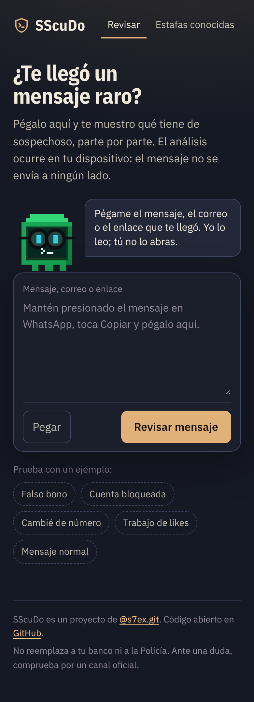
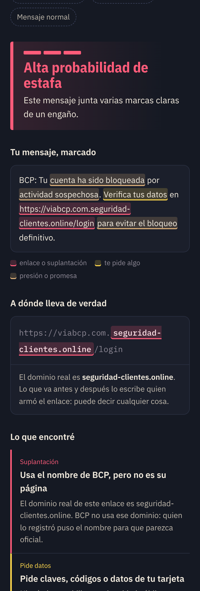

# SScuDo

**Pega un mensaje sospechoso y mira qué tiene de raro, parte por parte.**
Un revisor de estafas digitales pensado para el Perú, con Term ([@s7ex.git](https://www.instagram.com/s7ex.git/)). El análisis ocurre en tu dispositivo: el mensaje no se envía a ningún servidor.

> Estado: **v0.1, prueba.** Funciona, pero todavía no se probó con mensajes reales ni en un celular real. Ver [Estado y límites](#estado-y-límites).

<p>
  
  
</p>

## Qué hace

- **Marca el mensaje**: subraya las frases que presionan, prometen, amenazan o piden datos.
- **Abre el enlace sin abrirlo**: separa el dominio real de lo que es decoración. En `https://viabcp.com.seguridad-clientes.online/login`, el dominio real es `seguridad-clientes.online`.
- **Reconoce campañas peruanas**: falso bono, cuenta bloqueada, código de WhatsApp "por error", "cambié de número", trabajo de likes, paquete retenido, retiro de AFP o CTS, entre otras. Cada una explica cómo funciona y qué hacer.
- **Da un veredicto de tres niveles**: alta probabilidad de estafa, sospechoso o "no encontré señales". Nunca dice "es seguro".
- **Dice lo que no revisó**, siempre.
- **Se instala como app** y funciona sin conexión. En Android puede recibir texto desde "Compartir".

## Probarlo

```bash
npm install
npm run dev        # http://localhost:5180
npm test           # pruebas del motor
npm run build      # genera dist/
```

Para publicarlo en GitHub Pages: Settings → Pages → Source: **GitHub Actions**. El flujo `.github/workflows/pages.yml` hace el resto en cada push a `main`.

## Cómo decide

No usa un modelo de IA ni servicios externos: son reglas legibles, en `src/engine/`. Así cualquiera puede leer por qué un mensaje se marcó, y la app corre en un celular modesto sin enviar nada. El detalle está en [docs/COMO_FUNCIONA.md](docs/COMO_FUNCIONA.md).

## Estado y límites

**Medición (11 nov 2026).** Los mensajes de prueba los redactamos nosotros a partir de descripciones públicas de cada campaña. **No son capturas reales**, así que estas cifras dicen si el motor hace lo que promete, no cuánto acierta en la calle.

| Conjunto | Estafas detectadas | Legítimos marcados por error |
|---|---|---|
| Ajuste (`tests/dataset.ts`), usado para calibrar | 39 de 39 | 0 de 30 |
| Reserva (`tests/reserva.ts`), primera pasada sin tocar reglas | 14 de 20 | 0 de 20 |
| Reserva, después de generalizar reglas con sus fallos | 20 de 20 | 0 de 20 |

La cifra honesta es la del medio: **14 de 20** frente a redacciones que el motor no había visto. La tercera fila ya no cuenta como reserva.

**Sin verificar todavía**
- Mensajes de estafa reales. Es lo primero que falta.
- Un celular real: instalación como app y "Compartir → SScuDo" en Android. En iPhone, compartir hacia una app web no está disponible.
- La publicación en GitHub Pages.
- La lista de dominios oficiales (`src/engine/brands.ts`) necesita una revisión entidad por entidad.

**Límites de diseño**
- No abre enlaces, no consulta la antigüedad de un dominio y no lee imágenes ni audios.
- Reconoce patrones conocidos. Una estafa nueva o bien escrita puede pasar sin marca.
- No reemplaza a tu banco ni a la Policía.

## Lo que sigue

1. Juntar mensajes reales (con datos personales borrados) y medir contra ellos.
2. Leer capturas de pantalla (texto en imágenes).
3. Reportes de la comunidad y lista de campañas activas por semana.
4. Tarjeta de resultado como imagen para compartir.

Para sumar una campaña, una señal o una marca: [docs/AGREGAR_CAMPANA.md](docs/AGREGAR_CAMPANA.md).

## Estructura

```
src/engine/   motor: normalización, señales, enlaces, marcas, campañas, veredicto
src/App.tsx   interfaz
src/term/     Term (derechos reservados)
tests/        conjuntos de prueba y medición
public/       manifiesto, service worker, iconos
```

## Licencia

El código es MIT ([LICENSE](LICENSE)). **Term**, su diseño y los iconos (`src/term/`, `public/iconos/`) tienen todos los derechos reservados ([src/term/LICENSE](src/term/LICENSE)): si haces un fork, reemplázalos por los tuyos.

Fuentes IBM Plex bajo SIL Open Font License. Las fuentes de cada campaña están enlazadas en la propia app.
