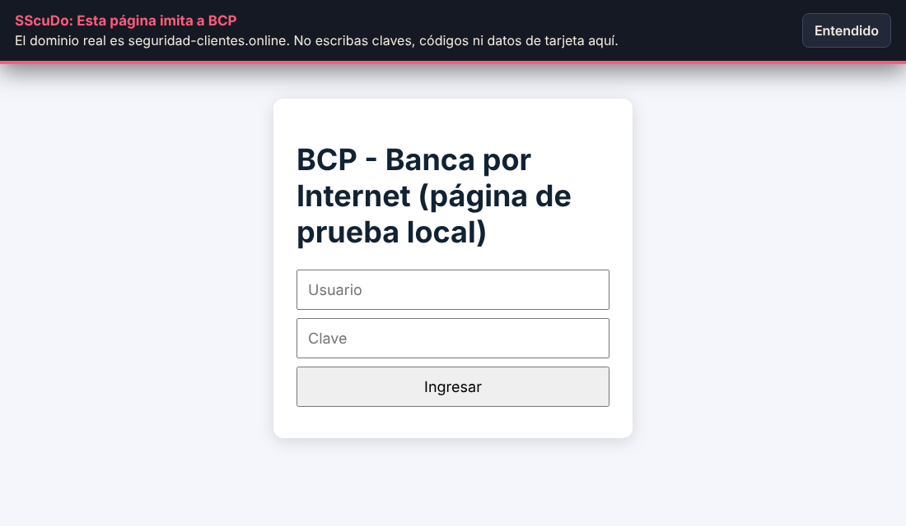
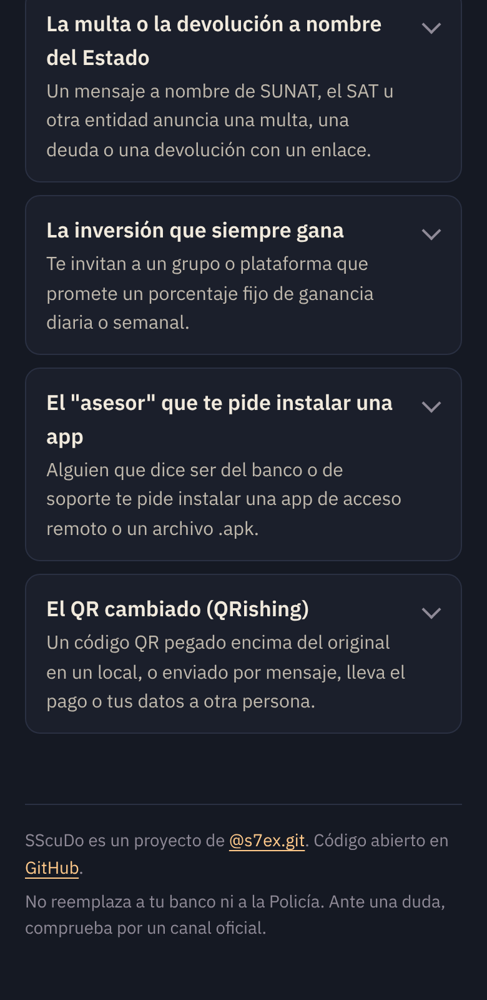

# SScuDo

**Pega un mensaje sospechoso y mira qué tiene de raro, parte por parte.**
Un revisor de estafas digitales pensado para el Perú, con Term ([@s7ex.git](https://www.instagram.com/s7ex.git/)). El análisis ocurre en tu dispositivo: el mensaje no se envía a ningún servidor.

**Página y descargas: https://s7ex-j.github.io/SScuDo/**

> Estado: **v0.2, prueba.** Funciona, pero todavía no se probó con mensajes reales ni en un celular real. Ver [Estado y límites](#estado-y-límites).

<p>
  
  
</p>

## Qué hace

- **Marca el mensaje**: subraya las frases que presionan, prometen, amenazan o piden datos.
- **Abre el enlace sin abrirlo**: separa el dominio real de lo que es decoración. En `https://viabcp.com.seguridad-clientes.online/login`, el dominio real es `seguridad-clientes.online`.
- **Reconoce campañas peruanas**: falso bono, cuenta bloqueada, código de WhatsApp "por error", "cambié de número", trabajo de likes, paquete retenido, retiro de AFP o CTS, entre otras. Cada una explica cómo funciona y qué hacer.
- **Da un veredicto de tres niveles**: alta probabilidad de estafa, sospechoso o "no encontré señales". Nunca dice "es seguro".
- **Dice lo que no revisó**, siempre.
- **Se instala como app** y funciona sin conexión. En Android puede recibir texto desde "Compartir".

## App de Android

Además de revisar mensajes pegados, compartidos o seleccionados, tiene dos protecciones opcionales:

- **Revisor de enlaces:** si la eliges como app para abrir enlaces, mira cada dirección en el momento del toque y la pasa a tu navegador. Solo aparece cuando hay señales.
- **Aviso de mensajes:** con acceso a notificaciones, lee el texto de cada mensaje que llega y alerta solo ante una estafa clara.

No vigila la pantalla ni usa el servicio de accesibilidad, y no deja procesos corriendo. Detalle, instalación y firma: [docs/ANDROID.md](docs/ANDROID.md).

## Extensión para el navegador

La misma revisión, mientras navegas en la PC (Chrome, Edge, Brave).

<p>
  
</p>

- **Aviso en la página** cuando el dominio imita a un banco, billetera o entidad, o cuando una página ajena pide una clave a su nombre.
- **Marca en el icono**: `!` riesgo alto, `?` sospechoso, `✓` dominio oficial de la lista.
- **Ventana** con el dominio real de la página y un cuadro para pegar mensajes.
- **Clic derecho → "Revisar con SScuDo"** sobre un texto o un enlace.

Solo mira la dirección, el título y si la página tiene campos de clave o tarjeta. No lee lo que escribes, no guarda historial y no hace peticiones de red.

**Instalarla (modo desarrollador):**

```bash
npm install
npm run build:ext      # genera dist-extension/
```

Luego abre `chrome://extensions`, activa "Modo de desarrollador", pulsa "Cargar descomprimida" y elige `dist-extension/`. Sin compilar: descarga `sscudo-extension` desde la última ejecución de Actions.

**Límites:** no está en la Chrome Web Store; Chrome en Android no admite extensiones; "✓" significa "está en nuestra lista", no una garantía; y no muestra reportes de otras personas, porque eso necesita un servidor que aún no existe.

## Reportes de la comunidad

Cuando 3 personas distintas reportan el mismo dominio, SScuDo lo advierte a los siguientes, y la lista de estafas se ordena por reportes de la semana. Al reportar se envía solo el dominio y el tipo de estafa: nunca el mensaje, ni teléfonos, ni la IP. Cómo funciona, sus límites y cómo publicarlo: [docs/REPORTES.md](docs/REPORTES.md).

<p>
  
</p>

Está **apagado hasta que se publique el servicio** (`worker/`). La captura es de una prueba local con datos de ejemplo.

## Probarlo

```bash
npm install
npm run dev        # http://localhost:5180
npm test           # pruebas del motor
npm run build      # genera dist/
```

Publicación: cada push a `main` actualiza la página (`pages.yml`); cada cambio del archivo `VERSION` compila el APK y la extensión y los sube a Releases (`release.yml`).

## Cómo decide

No usa un modelo de IA ni servicios externos: son reglas legibles, en `src/engine/`. Así cualquiera puede leer por qué un mensaje se marcó, y la app corre en un celular modesto sin enviar nada. El detalle está en [docs/COMO_FUNCIONA.md](docs/COMO_FUNCIONA.md).

## Estado y límites

**Medición (11 nov 2026).** Los mensajes de prueba los redactamos nosotros a partir de descripciones públicas de cada campaña. **No son capturas reales**, así que estas cifras dicen si el motor hace lo que promete, no cuánto acierta en la calle.

| Conjunto | Estafas detectadas | Legítimos marcados por error |
|---|---|---|
| Ajuste (`tests/dataset.ts`), usado para calibrar | 39 de 39 | 0 de 30 |
| Reserva (`tests/reserva.ts`), primera pasada sin tocar reglas | 14 de 20 | 0 de 20 |
| Reserva, después de generalizar reglas con sus fallos | 20 de 20 | 0 de 20 |

La cifra honesta es la del medio: **14 de 20** frente a redacciones que el motor no había visto. La tercera fila ya no cuenta como reserva.

**Sin verificar todavía**
- Mensajes de estafa reales. Es lo primero que falta.
- **App de Android:** la v0.2.0 se probó una vez en un teléfono (13/11/2026). Seleccionar texto → SScuDo funcionó; "Compartir" no sirve con texto de WhatsApp ni de Mensajes; los enlaces acortados pasaban sin revisarse. Lo corregido después (desacortar, revisar lo copiado, botón de ajustes rápidos, nuevo diseño) compila en CI pero **todavía no se probó en un teléfono**.
- La app web instalada en un celular real y su "Compartir → SScuDo".
- El despliegue automático del servicio en Cloudflare (`servicio.yml`) no se ejecutó con credenciales reales.
- La extensión se probó cargada en Chrome real contra páginas de prueba locales (4 de 4 casos), no contra páginas de phishing reales ni en uso diario. El clic derecho no se probó.
- El servicio (reportes y revisión de páginas) pasó sus pruebas en local (18 casos, con páginas inventadas y un fetch simulado), pero no está publicado: faltan los secretos de Cloudflare en el repositorio. La captura de pantalla (Browser Rendering) no se probó: solo existe en Cloudflare. La extensión todavía no usa la lista de reportes.
- Dominios oficiales: todos los dominios de `brands.ts` tienen fuente anotada y están fijados en una prueba. El detalle está en [docs/DOMINIOS.md](docs/DOMINIOS.md).

**Límites de diseño**
- Al revisar un mensaje no abre enlaces ni consulta la antigüedad de un dominio. Eso solo pasa si tocas "Ver la página sin abrirla": el servicio abre la página desde Cloudflare (nunca desde tu teléfono) y solo recibe la dirección. No lee imágenes ni audios.
- Reconoce patrones conocidos. Una estafa nueva o bien escrita puede pasar sin marca.
- No reemplaza a tu banco ni a la Policía.

## Lo que sigue

El orden completo, con quién hace cada paso y cómo se comprueba, está en
[docs/HOJA_DE_RUTA.md](docs/HOJA_DE_RUTA.md). En corto:

1. Probar el APK y la extensión en uso real.
2. Firmar el APK y publicar el servicio de reportes; conectar la extensión y Android a la lista.
3. Medir contra mensajes reales y generalizar las reglas que fallen.

Cómo encajan las piezas: [docs/ARQUITECTURA.md](docs/ARQUITECTURA.md).

Para sumar una campaña, una señal o una marca: [docs/AGREGAR_CAMPANA.md](docs/AGREGAR_CAMPANA.md).

## Estructura

```
src/engine/   motor: normalización, señales, enlaces, marcas, campañas, veredicto
src/App.tsx   interfaz
index.html    página de presentación (la app web vive en app/)
android/      app de Android (Kotlin; usa el mismo motor en un WebView sin red)
extension/    extensión del navegador (usa el mismo motor)
worker/       servicio de reportes (Cloudflare Workers + D1)
src/term/     Term (derechos reservados)
tests/        conjuntos de prueba y medición
public/       manifiesto, service worker, iconos
```

## Licencia

El código es MIT ([LICENSE](LICENSE)). **Term**, su diseño y los iconos (`src/term/`, `public/iconos/`) tienen todos los derechos reservados ([src/term/LICENSE](src/term/LICENSE)): si haces un fork, reemplázalos por los tuyos.

Fuentes IBM Plex bajo SIL Open Font License. Las fuentes de cada campaña están enlazadas en la propia app.
